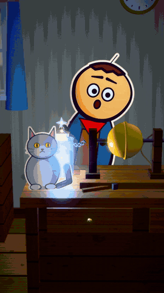

# Shorts Skills for Codex and Claude Code

**English** · [Bahasa Indonesia](README.id.md)

[](https://github.com/fahniazz/claude-shorts-skills/actions/workflows/check.yml) [](LICENSE) [](https://github.com/fahniazz/claude-shorts-skills/stargazers)

Four skills for making vertical short videos (YouTube Shorts, TikTok, Reels): animated 3D stories, word-synced captions, Minecraft scripts, and code-driven Minecraft stories. [Codex](https://developers.openai.com/codex/) discovers the project adapters in this checkout. [Claude Code](https://claude.com/claude-code) uses the original skills. The cartoon workflow renders with three.js inside [Remotion](https://www.remotion.dev/).

## Made with these skills

<p align="center">
  <a href="https://www.youtube.com/shorts/SyGejh7OGvc"></a>
  <a href="https://www.youtube.com/shorts/-dr5RuXq-is"></a>
  <a href="https://www.youtube.com/shorts/JcwlOpPGPBg"></a>
  <a href="https://www.youtube.com/shorts/D0rqckAfzV8"></a>
</p>
<p align="center"><i>Click a clip to watch the full short on YouTube.</i></p>

Every frame is rendered on a home PC with three.js inside Remotion; no AI video generator, no stock footage.

### More videos made with these skills

| Channel | Videos |
|---|---|
| [UntoldAnimation](https://www.youtube.com/@UntoldAnimationYT) (English, `cartoon-3d-short`) | [Why Perfect Escape Tunnels Collapse](https://www.youtube.com/shorts/WZYyPAWdEp4) · [The Ships That Climbed a Hill](https://www.youtube.com/shorts/Gdv81sMPrAI) · [The Plumber Who Held the Door for the Mona Lisa Thief](https://www.youtube.com/shorts/pZ3_YFUlHmw) · [Stopped by Thin Air](https://www.youtube.com/shorts/dZ-4eEUPRvQ) · [The Thief Who Died On Time](https://www.youtube.com/shorts/RD29XwYLITE) · [The Thief Who Cried Wolf](https://www.youtube.com/shorts/xkngcssRhjw) |
| [RubyBlocked](https://www.youtube.com/@RubyBlocked) (English, Minecraft) | [In This Town, Forgotten Blocks Vanish](https://www.youtube.com/shorts/eRC9rXeqTPQ) (`minecraft-story`) · [How You Invented the Cobblestone Generator](https://www.youtube.com/shorts/pE9Wfs5ZrcA) · [How You Invented the Mob Farm](https://www.youtube.com/shorts/CXSxaww4vPU) |
| [iFanz](https://www.youtube.com/@iFanzYT) (Indonesian, Minecraft) | [Upgrade Rumah Minecraft Sampai Kebablasan](https://www.youtube.com/shorts/ZavYvrUcA8Q) |

## The skills

| Skill | What it does |
|---|---|
| [`cartoon-3d-short`](skills/cartoon-3d-short) | 55-70 s vertical cartoon story shorts: 2D characters in a 3D world. Script formulas, voice-over, shot plan, camera, acting presets, sound mix, QA review agents and the final render. Looks: painted, PBR, paper diorama, Minecraft voxel. |
| [`captions`](skills/captions) | Word-synced captions as a separate green-screen (and optional ProRes 4444 alpha) clip for After Effects, timed to the narration and kept clear of the Shorts UI. |
| [`minecraft-shorts`](skills/minecraft-shorts) | Minecraft short scripts in English and Indonesian with two formulas ("What happens if...?" and the "how you built X" evolution ladder), an in-game test list and a Replay Mod shot list. |
| [`minecraft-story`](skills/minecraft-story) | 2:15 "In this world / In this town" Minecraft stories: script, originality review, storyboard, and a parallel production wave for sets, visuals, and camera. `compile_shots.mjs` combines the layers and checks the result before game commands run. Recording uses RCON, Scarpet, and ReplayMod. The original workflow is in Indonesian. |

## Install

### Codex

Open Codex from this checkout and use `$cartoon-3d-short`, `$captions`, `$minecraft-shorts`, or `$minecraft-story`. Do not copy the skills into your home directory.

For Minecraft Story, run preflight before role work. Codex workers propose changes in a separate read-only session. The coordinator applies approved proposals through the ownership tool. See the [Codex guide](docs/codex.md) for preflight, gates, and wave commands.

Install the [runtime tools](docs/codex.md#runtime-setup) for the skill you use. Captions do not require Remotion. Cartoon production requires a [compatible Remotion host](docs/remotion-host.md); this checkout does not ship the director or voxel renderer.

### Claude Code

Step-by-step guide for beginners (Windows): [README.id.md](README.id.md) (Indonesian).

1. Clone this repo.
2. Copy the skills you want into `~/.claude/skills/`:
   ```bash
   cp -r skills/* ~/.claude/skills/
   ```
   For `minecraft-story`, also install its sub-agents with `node ~/.claude/skills/minecraft-story/scripts/install.mjs` and start a new Claude Code session.
3. Install the [runtime tools](docs/codex.md#runtime-setup) for the skill you use.
4. In Claude Code, ask for example: *"Use the cartoon short skill and make a short about the first elevator brake."*

#### Claude Code on macOS

> The skills were built and tested on Windows 11. The steps below should work on macOS, but have not been tested there yet: if something breaks, please report it in [issue #5](https://github.com/fahniazz/claude-shorts-skills/issues/5).

In Terminal:

```bash
# 1. Homebrew (skip if you have it), then the base tools
/bin/bash -c "$(curl -fsSL https://raw.githubusercontent.com/Homebrew/install/HEAD/install.sh)"
brew install git node python ffmpeg

# 2. Claude Code (run `claude` once and log in)
npm install -g @anthropic-ai/claude-code

# 3. + 4. Get the skills and copy them into Claude's folder
git clone https://github.com/fahniazz/claude-shorts-skills
mkdir -p ~/.claude/skills && cp -r claude-shorts-skills/skills/* ~/.claude/skills/
node ~/.claude/skills/minecraft-story/scripts/install.mjs   # only for minecraft-story

# 5. For cartoons, open your compatible Remotion host, then start Claude there.
claude
```

See the [Remotion host requirements](docs/remotion-host.md). A new `create-video` project does not include the director gate.

Rendering uses Remotion's own browser unless you set `CHROME_PATH`, and the caption script picks Arial Black (or DejaVu Sans Bold on Linux) by itself; pass `--font` to use another font.

## Settings

| Variable | Used for |
|---|---|
| `REMOTION_TMP` | Temp folder for Remotion bundles; put it on a big drive (defaults to the system temp folder). |
| `CHROME_PATH` | Optional Chrome/Chromium for rendering. If unset, the scripts use Chrome's usual Windows install when it exists, otherwise Remotion's own downloaded browser. |
| `ELEVENLABS_API_KEY` | Optional AI voice (`templates/scripts/eleven_voice.py`). Put it in your project's `.env`; never commit it. |
| `HF_CACHE_DIR` | Optional cache folder for the faster-whisper model used for word timings. |
| `<ASSETS_DIR>` | In the docs, the folder where you keep your own asset kits (for example [Kenney](https://kenney.nl/) CC0 models). |

## Rules the skills follow

- Story, characters and voice are your own. References are for measuring the look, never for copying content.
- Sound effects are recorded (CC0 / free-licence), not synthesised.
- Characters and captions stay inside the YouTube Shorts safe zone.

## Contributing

Pull requests are welcome. Start with a [`good first issue`](https://github.com/fahniazz/claude-shorts-skills/labels/good%20first%20issue) and read [CONTRIBUTING.md](CONTRIBUTING.md).

## Credits

`cartoon-3d-short` started from the MIT-licensed skill by **Mr omi** (see [`skills/cartoon-3d-short/LICENSE`](skills/cartoon-3d-short/LICENSE)) and was extended here with the diorama and Minecraft looks, an AI director, motion presets, a recorded-SFX audio pipeline, review agents and lessons from shipped shorts. Third-party reference frames from the original package are not included in this repo.

Minecraft is a trademark of Mojang Synergies AB. This project is not affiliated with Mojang or Microsoft.

## License

MIT, see [`LICENSE`](LICENSE). The cartoon skill keeps its [original MIT notice](skills/cartoon-3d-short/LICENSE).
