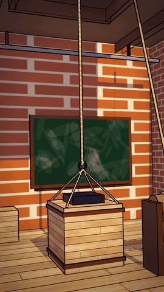
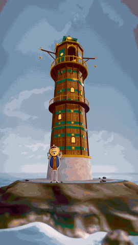

# Claude Shorts Skills

Three [Claude Code](https://claude.com/claude-code) skills for making vertical short videos (YouTube Shorts, TikTok, Reels) on your own PC: animated 3D story shorts, word-synced captions, and Minecraft short scripts. No AI video generator: the picture is rendered with three.js inside [Remotion](https://www.remotion.dev/).

## Made with these skills

| Cut the Rope | How You Invented Electricity | Saved by the Stink | How You Invented the Lighthouse |
|:-:|:-:|:-:|:-:|
|  |  |  |  |
Every frame is rendered on a home PC with three.js inside Remotion; no AI video generator, no stock footage.

## The skills

| Skill | What it does |
|---|---|
| [`cartoon-3d-short`](skills/cartoon-3d-short) | 55-70 s vertical cartoon story shorts: 2D characters in a 3D world. Script formulas, voice-over, shot plan, camera, acting presets, sound mix, QA review agents and the final render. Looks: painted, PBR, paper diorama, Minecraft voxel. |
| [`captions`](skills/captions) | Word-synced captions as a separate green-screen (and optional ProRes 4444 alpha) clip for After Effects, timed to the narration and kept clear of the Shorts UI. |
| [`minecraft-shorts`](skills/minecraft-shorts) | Minecraft short scripts in English and Indonesian with two formulas ("What happens if...?" and the "how you built X" evolution ladder), an in-game test list and a Replay Mod shot list. |

## Install

1. Clone this repo.
2. Copy the skills you want into `~/.claude/skills/`:
   ```bash
   cp -r skills/* ~/.claude/skills/
   ```
3. Install the tools the video skills use: Node 20+, [Remotion](https://www.remotion.dev/) with `@remotion/three`, Python 3 and ffmpeg.
4. In Claude Code, ask for example: *"Use the cartoon short skill and make a short about the first elevator brake."*

## Settings

| Variable | Used for |
|---|---|
| `REMOTION_TMP` | Temp folder for Remotion bundles; put it on a big drive (defaults to the system temp folder). |
| `ELEVENLABS_API_KEY` | Optional AI voice (`templates/scripts/eleven_voice.py`). Put it in your project's `.env`; never commit it. |
| `HF_CACHE_DIR` | Optional cache folder for the faster-whisper model used for word timings. |
| `<ASSETS_DIR>` | In the docs, the folder where you keep your own asset kits (for example [Kenney](https://kenney.nl/) CC0 models). |

## Rules the skills follow

- Story, characters and voice are your own. References are for measuring the look, never for copying content.
- Sound effects are recorded (CC0 / free-licence), not synthesised.
- Characters and captions stay inside the YouTube Shorts safe zone.

## Credits

`cartoon-3d-short` started from the MIT-licensed skill by **Mr omi** (see [`skills/cartoon-3d-short/LICENSE`](skills/cartoon-3d-short/LICENSE)) and was extended here with the diorama and Minecraft looks, an AI director, motion presets, a recorded-SFX audio pipeline, review agents and lessons from shipped shorts. Third-party reference frames from the original package are not included in this repo.

Minecraft is a trademark of Mojang Synergies AB. This project is not affiliated with Mojang or Microsoft.

## License

MIT, see [`LICENSE`](LICENSE). `skills/cartoon-3d-short` keeps its original MIT notice as well.
